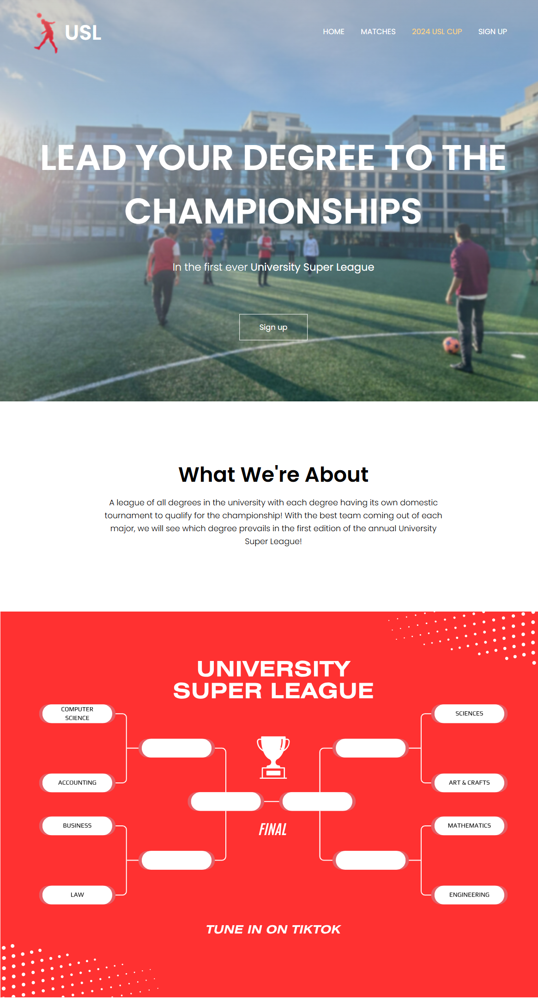
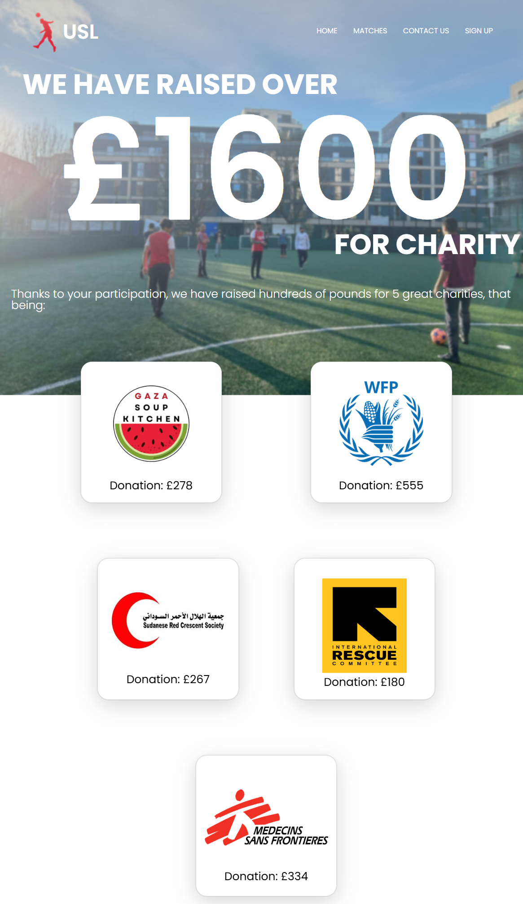
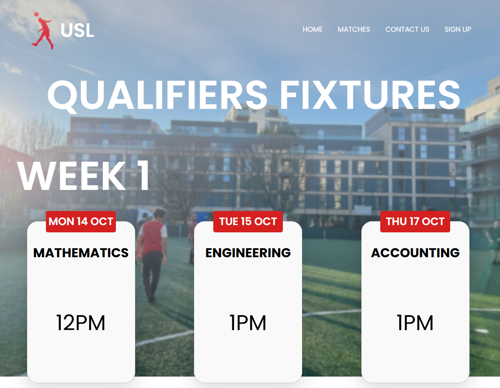

# University Super League

The website for University Super League, a charity football tournament between degree courses at City St George's, University of London, co-founded by five of us in autumn 2024. Each degree played qualifiers to send its best team to the championship, and the tournament raised over £1,600 for five charities.

## What it does

- **Team and player sign-up**, stored in a MySQL database through a small Flask backend
- **Online entry payments** through Stripe Checkout, with success and cancel pages for the payment flow
- **Fixtures and results** for the qualifiers and the final
- **About, terms of service** and an SEO sitemap
- **Transaction transparency:** a published export of payments received, showing the total raised for charity without exposing any customer data

## Tech stack

HTML, CSS and JavaScript frontend · Python (Flask) and MySQL for sign-ups · Stripe payments backend in Ruby · hosted on Render.

## My role

I co-founded the tournament with four friends and worked across the platform: I built the Stripe payment processing backend in Ruby (kept in a separate private repo), designed the relational database schema for teams, players and payments, and contributed to the frontend.

## Status

The tournament has finished and the live site is no longer hosted.

## Team

Built by the five University Super League co-founders.
